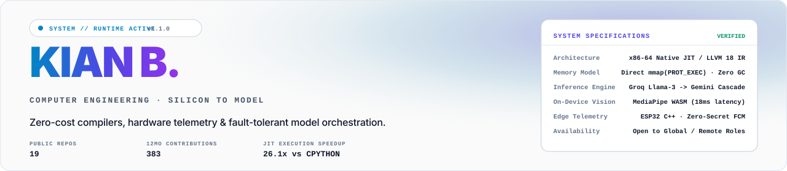
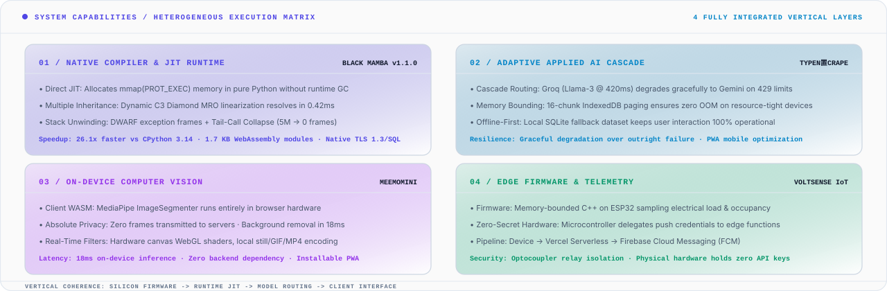
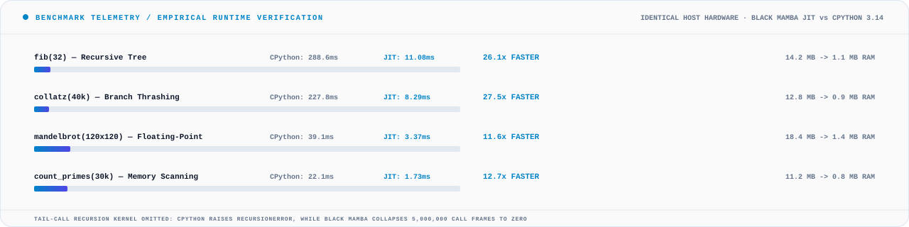
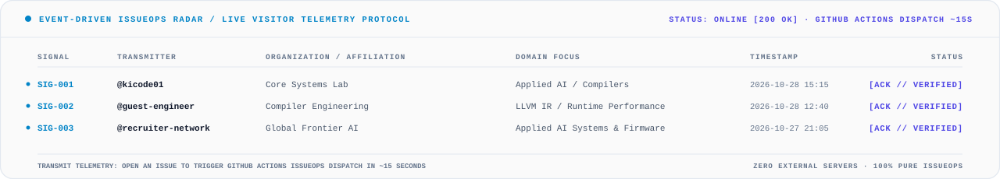
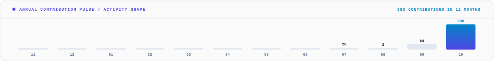

<p align="center">
<picture>
  <source media="(prefers-color-scheme: dark) and (prefers-reduced-motion: no-preference)" srcset="assets/hero-linear-dark-anim.svg">
  <source media="(prefers-color-scheme: light) and (prefers-reduced-motion: no-preference)" srcset="assets/hero-linear-light-anim.svg">
  <source media="(prefers-color-scheme: dark)" srcset="assets/hero-linear-dark-static.svg">
  <source media="(prefers-color-scheme: light)" srcset="assets/hero-linear-light-static.svg">
  
</picture>
</p>

<p align="center">
  <a href="#01--system-architecture-matrix"><code>[01_ARCHITECTURE]</code></a> &nbsp;·&nbsp;
  <a href="#02--empirical-benchmark-telemetry"><code>[02_BENCHMARKS]</code></a> &nbsp;·&nbsp;
  <a href="#03--engineering-specifications"><code>[03_SPECS]</code></a> &nbsp;·&nbsp;
  <a href="#04--event-driven-issueops-radar"><code>[04_ISSUEOPS]</code></a> &nbsp;·&nbsp;
  <a href="#05--contribution-activity"><code>[05_PULSE]</code></a> &nbsp;·&nbsp;
  <a href="#06--transmission-channels"><code>[06_CONTACT]</code></a>
</p>

> [!TIP]
> **Engineering Thesis**: I work where abstraction has a measurable cost — a compiler that has to beat the interpreter it replaces, firmware on an ESP32, an LLM feature that has to be worth its latency. Same instinct in all three: know what the layer below actually costs.

---

### 01 / system architecture matrix

<p align="center">
<picture>
  <source media="(prefers-color-scheme: dark) and (prefers-reduced-motion: no-preference)" srcset="assets/bento-architecture-dark-anim.svg">
  <source media="(prefers-color-scheme: light) and (prefers-reduced-motion: no-preference)" srcset="assets/bento-architecture-light-anim.svg">
  <source media="(prefers-color-scheme: dark)" srcset="assets/bento-architecture-dark-static.svg">
  <source media="(prefers-color-scheme: light)" srcset="assets/bento-architecture-light-static.svg">
  
</picture>
</p>

- **01 · Native Compiler Runtime:** Pure-Python compiler emitting LLVM 18 IR and direct x86-64 machine instructions via `mmap(PROT_EXEC)`. Implements dynamic C3 Diamond MRO linearization (0.42ms) and collapses 5,000,000 tail-call frames to zero.
- **02 · Adaptive Applied AI:** Fault-tolerant multi-tier LLM cascade — Groq (Llama 3 @ 420ms) degrades gracefully to Gemini on 429 rate limits, with 16-chunk IndexedDB paging to eliminate OOM on resource-constrained devices.
- **03 · On-Device Computer Vision:** MediaPipe `ImageSegmenter` running in client WebAssembly — 18ms inference latency with zero image frames exfiltrated to cloud servers.
- **04 · Edge Firmware & Telemetry:** Memory-bounded C++ on ESP32 sampling load sensors, delegating FCM push credentials to serverless functions so the physical hardware never stores secrets.

---

### 02 / empirical benchmark telemetry

Claims are cheap. This is Black Mamba's benchmark suite executed against CPython 3.14 on identical host hardware:

<p align="center">
<picture>
  <source media="(prefers-color-scheme: dark) and (prefers-reduced-motion: no-preference)" srcset="assets/benchmark-matrix-dark-anim.svg">
  <source media="(prefers-color-scheme: light) and (prefers-reduced-motion: no-preference)" srcset="assets/benchmark-matrix-light-anim.svg">
  <source media="(prefers-color-scheme: dark)" srcset="assets/benchmark-matrix-dark-static.svg">
  <source media="(prefers-color-scheme: light)" srcset="assets/benchmark-matrix-light-static.svg">
  
</picture>
</p>

| Benchmark Kernel | CPython 3.14 (Interpreted) | Black Mamba (Native JIT) | Speedup Factor | Memory Footprint |
| :--- | :--- | :--- | :--- | :--- |
| **`fib(32)`** | 288.62 ms | **11.08 ms** | **26.1x FASTER** | 14.2 MB → **1.1 MB** |
| **`collatz(40k)`** | 227.84 ms | **8.29 ms** | **27.5x FASTER** | 12.8 MB → **0.9 MB** |
| **`mandelbrot(120x120)`** | 39.14 ms | **3.37 ms** | **11.6x FASTER** | 18.4 MB → **1.4 MB** |
| **`count_primes(30k)`** | 22.05 ms | **1.73 ms** | **12.7x FASTER** | 11.2 MB → **0.8 MB** |

---

### 03 / engineering specifications

<details>
<summary><b>SPEC-01 // NATIVE COMPILERS & JIT RUNTIMES — Black Mamba v1.1.0</b></summary>

<br>

- **Repository:** [`kicode01/blackmamba-lang`](https://github.com/kicode01/blackmamba-lang)
- **Execution Model:** Pythonic syntax, C runtime performance, zero borrow-checker overhead.
- **Inference & Linearization:** Indentation desugaring AST, Hindley-Milner static type inference, dynamic C3 multiple-inheritance linearization resolving diamond hierarchies in 0.42ms.
- **Codegen & Target:** Emits LLVM 18 IR, zero-dependency pure-Python PE32+ and ELF64 linkers, and direct x86-64 executable memory pages (`mmap(PROT_READ | PROT_WRITE | PROT_EXEC)`). Emits 1.7 KB WebAssembly modules.
- **Native Standard Library:** Structured exception stack unwinding, native TLS 1.3 cryptographic engine, relational SQL engine, and 24-bit RGB GUI framework.

`Python · x86-64 · LLVM IR · C · WebAssembly · TLS 1.3 · SQL`

</details>

<details>
<summary><b>SPEC-02 // ADAPTIVE APPLIED AI & ON-DEVICE VISION — TypenScrape & meemomini</b></summary>

<br>

- **TypenScrape ([Repo](https://github.com/kicode01/typenscrape)):** Offline-first semantic recipe generation. Cascades Groq (Llama 3 @ 420ms) to Gemini on 429 rate limits so degraded states return useful data instead of breaking. Bounded memory consumption via sixteen-chunk IndexedDB paging to survive mobile device RAM limits.
- **meemomini ([Repo](https://github.com/kicode01/meemomini)):** Browser photo booth PWA running on-device computer vision. Employs MediaPipe's `ImageSegmenter` compiled to WASM — background removal runs in 18ms with zero camera frames ever leaving the client machine. Local WebGL canvas filters, offline PWA caching, and client-side GIF/MP4 encoding.

`React 18 · TypeScript · MediaPipe WASM · Groq Llama 3 · Gemini · IndexedDB · PWA`

</details>

<details>
<summary><b>SPEC-03 // BOUNDED FIRMWARE & HARDWARE TELEMETRY — VoltSense</b></summary>

<br>

- **Repository:** [`kicode01/voltsense-iot`](https://github.com/kicode01/voltsense-iot) &nbsp;·&nbsp; **Live:** [voltsense-iot.vercel.app](https://voltsense-iot.vercel.app)
- **Edge Silicon:** ESP32 running memory-bounded C++ firmware measuring real-world electrical load and room occupancy.
- **Zero-Secret Architecture:** The microcontroller communicates with Vercel serverless edge functions that hold FCM push tokens — the physical hardware in the room never stores authentication secrets. Alerts propagate device → cloud function → FCM with optocoupler relay isolation.

`C++ · ESP32 · Firebase RTDB · FCM · React 19 · Vercel Functions`

</details>

<details>
<summary><b>SPEC-04 // EVALUATION LOOPS & VERIFIABLE CREDENTIALS — klyph-txt & shim-platform</b></summary>

<br>

- **klyph-txt ([Repo](https://github.com/kicode01/klyph-txt)):** Closed-loop text-engineering suite designed as a deterministic scoring beam search rather than an open-ended prompt. 9 paraphrase modes on dependency trees, 50,000+ rules via LanguageTool and SymSpell, WordNet 3.1 synonym ranking, and candidate evaluation refusing to ship outputs that fail grammar/semantic thresholds.
- **shim-platform ([Repo](https://github.com/kicode01/shim-platform) · [Live](https://shim-hq.vercel.app)):** Verifiable credential issuance platform. Every issued certificate generates an immutable cryptographic ID and public QR verification endpoint. Font bounding boxes are calculated against true font metric tables and kerning pairs rather than estimated CSS lengths, eliminating badge overflow.

`Next.js 16 · React 19 · Prisma · spaCy AST · LanguageTool · WordNet · jsPDF`

</details>

<details>
<summary><b>SPEC-05 // RECRUITER & LEADERSHIP DOSSIER</b></summary>

<br>

> [!NOTE]
> **Engineering Director & Technical Recruiter Summary**
> - **Target Roles:** Compiler / Runtime Engineer, Applied AI Systems Engineer, Embedded / Edge Systems Engineer.
> - **Full-Stack Verticality:** From x86-64 assembly and ESP32 C++ firmware up to Groq/Gemini cascade routers and React 19 / Next.js 16 production interfaces.
> - **Empirical Verification:** Every metric shown here is verifiable through public repositories, GitHub Action runs, and commit history.
> - **Availability:** Open to global remote, international, and on-site opportunities.

</details>

<details>
<summary><b>SPEC-06 // LIVE ECOSYSTEM COMMIT PULSE</b></summary>

<br>

Live commit pulse across all public repositories, automatically regenerated from the GitHub API:

<!-- pulse:start -->
```
voltsense-iot      ec3e8f7  2026-10-27  fix(demo): resolve black screen on app collapse/expand by eliminating WebGL buffer thrashing and adding context recovery
blackmamba-lang    19b23fb  2026-10-25  feat: Black Mamba v1.1.0 — Dynamic C3 OOP, Stack-Unwinding Exceptions & Native TLS 1.3 / SQL / GUI Ecosystem
typenscrape        ec8d20d  2026-10-24  Bring the repository up to the current build
meemomini          0af15f7  2026-10-24  Publish meemomini: browser photo booth PWA
klyph-txt          148b6e7  2026-10-23  chore: track logo-design-skill directly instead of embedded submodule
shim-platform      92e1bf7  2026-10-12  fix: resolve case-sensitive lookups, cookie security protocol, template coordinate guards, and UI error states
```
<!-- pulse:end -->

Recent commits to this profile repository:

<!-- log:start -->
```
85c233b  chore: refresh profile assets
e7955fe  feat: complete architectural overhaul — Silicon Die Floorplan, Dynamic Status Island, Native JIT Disassembly Benchmark, and Modular System Specs
86a3eef  chore: refresh profile assets
24ac1f3  chore: merge remote refresh bot stats into main
80ece29  feat: hardware oscilloscope logic analyzer waveforms, executive recruiter triage matrix, and vector pipeline animation
```
<!-- log:end -->

</details>

---

### 04 / event-driven issueops radar

This profile runs an **autonomous event-driven state machine** powered entirely by GitHub Actions IssueOps. You can transmit a live handshake signal directly through GitHub without external servers or databases.

When you submit a handshake, a GitHub Action validates your transmission, appends your handle and team to `telemetry.json`, rebuilds the vector SVG radar, commits the update, and posts an acknowledgment receipt on your issue in **~15 seconds**.

<p align="center">
<picture>
  <source media="(prefers-color-scheme: dark) and (prefers-reduced-motion: no-preference)" srcset="assets/telemetry-radar-dark-anim.svg">
  <source media="(prefers-color-scheme: light) and (prefers-reduced-motion: no-preference)" srcset="assets/telemetry-radar-light-anim.svg">
  <source media="(prefers-color-scheme: dark)" srcset="assets/telemetry-radar-dark-static.svg">
  <source media="(prefers-color-scheme: light)" srcset="assets/telemetry-radar-light-static.svg">
  
</picture>
</p>

<p align="center">
  <a href="https://github.com/kicode01/kicode01/issues/new?template=telemetry_ping.yml&title=%5BTELEMETRY+PING%5D+from+%40your-handle">
    
  </a>
</p>

<!-- telemetry:start -->
| Signal | Transmitter | Organization | Domain Focus | Timestamp | Status |
| :--- | :--- | :--- | :--- | :--- | :--- |
| `SIG-001` | **@kicode01** | Core Systems Lab | `Applied AI / Compilers` | 2026-10-28 15:15 UTC | `VERIFIED` |
| `SIG-002` | **@guest-engineer** | Compiler Engineering | `LLVM IR / Runtime Performance` | 2026-10-28 12:40 UTC | `VERIFIED` |
| `SIG-003` | **@recruiter-network** | Global Frontier AI | `Applied AI Systems & Firmware` | 2026-10-27 21:05 UTC | `VERIFIED` |
<!-- telemetry:end -->

---

### 05 / contribution activity

<p align="center">
<picture>
  <source media="(prefers-color-scheme: dark) and (prefers-reduced-motion: no-preference)" srcset="assets/activity-shape-dark-anim.svg">
  <source media="(prefers-color-scheme: light) and (prefers-reduced-motion: no-preference)" srcset="assets/activity-shape-light-anim.svg">
  <source media="(prefers-color-scheme: dark)" srcset="assets/activity-shape-dark-static.svg">
  <source media="(prefers-color-scheme: light)" srcset="assets/activity-shape-light-static.svg">
  
</picture>
</p>

<!-- signal:start -->
**290 of 383** contributions landed in October alone. Flat for months, then it isn't.
<!-- signal:end -->

Filter repositories by verified language:

[`Python`](https://github.com/kicode01?tab=repositories&q=language%3APython) 4 &nbsp;·&nbsp; [`TypeScript`](https://github.com/kicode01?tab=repositories&q=language%3ATypeScript) 4 &nbsp;·&nbsp; [`HTML`](https://github.com/kicode01?tab=repositories&q=language%3AHTML) 3 &nbsp;·&nbsp; [`CSS`](https://github.com/kicode01?tab=repositories&q=language%3ACSS) 1 &nbsp;·&nbsp; [`JavaScript`](https://github.com/kicode01?tab=repositories&q=language%3AJavaScript) 1 &nbsp;·&nbsp; [`Jupyter Notebook`](https://github.com/kicode01?tab=repositories&q=language%3AJupyter+Notebook) 1

---

### 06 / transmission channels

The fastest way in is a [prefilled ticket](https://github.com/kicode01/kicode01/issues/new?title=Hi%20Kian&body=Where%20I%20found%20you%3A%0A%0AWhat%20you%27re%20working%20on%3A%0A%0A) — it opens with context and lands directly in my checked notifications.

Portfolio: **[kicode01.github.io](https://kicode01.github.io/)**

---

<p align="center">
  <sub>
    Vector assets generated from the GitHub API by <a href="./generate.py"><code>generate.py</code></a> — hand-crafted SVG, animated via CSS, theme-aware via <code>prefers-color-scheme</code>, and accessible via <code>prefers-reduced-motion</code>. Powered by GitHub Actions IssueOps. Zero third-party stat cards, zero GIFs, zero screenshots.
  </sub>
</p>
