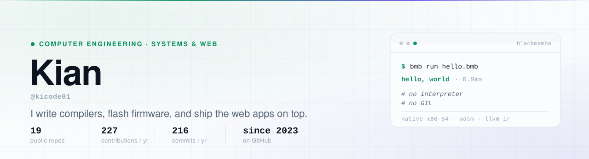
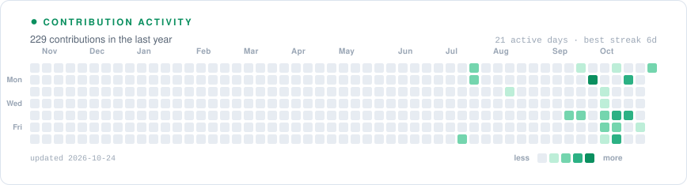

<picture>
  <source media="(prefers-color-scheme: dark)" srcset="assets/hero-dark.svg">
  <source media="(prefers-color-scheme: light)" srcset="assets/hero-light.svg">
  
</picture>

> **Building now** — [Black Mamba](https://github.com/kicode01/blackmamba-lang), a language with Python's syntax and C's execution model. &nbsp;·&nbsp; **Open to** software engineering internships.

I'm a Computer Engineering student. I work where abstraction has a measurable cost: a compiler that has to beat the interpreter it replaces, firmware running on an ESP32, a storefront that has to hold frame rate while rendering a 3D model. The three projects below are the ones I'd want you to read first.

---

## Selected work

### [Black Mamba](https://github.com/kicode01/blackmamba-lang) · a compiler that refuses to choose

Python's syntax, C's execution model, no borrow checker in between. A hand-written lexer and parser, an x86-64 JIT that allocates executable memory directly, zero-dependency PE32+ and ELF64 linkers written in pure Python, and a WebAssembly backend that emits 1.7 KB modules. Automatic tail-call optimization collapses 5,000,000 recursive frames into zero stack frames.

On the repo's own benchmark suite it runs recursive `fib(32)` **26× faster than CPython 3.14** and produces a 5.5 KB standalone `.exe` with no runtime.

`Python · x86-64 · LLVM IR · C · WebAssembly` — MIT

### [VoltSense](https://github.com/kicode01/voltsense-iot) · firmware, serverless, and the app in between

An ESP32 measures a room's real electrical load and occupancy, publishes telemetry to Firebase, and exposes per-port relay control. Three deliberately separate layers: C++ firmware, Vercel functions that hold the push credentials so the device never has to, and a React 19 PWA that an operator would actually use. Alerts travel device → server → FCM without the device ever holding a messaging key.

**[Live demo →](https://voltsense-iot.vercel.app)**

`C++ · ESP32 · Firebase RTDB · FCM · React 19 · Vercel`

### [klyph-txt](https://github.com/kicode01/klyph-txt) · text as a syntax tree, not a string

A neurosymbolic writing suite where every rewrite is a deterministic AST transformation rather than a prompt. Nine paraphrase modes built on dependency-tree restructuring, 50,000+ grammar rules via LanguageTool and SymSpell, WordNet 3.1 synonym ranking, and a closed-loop beam search that scores structural candidates before picking one.

`Python · spaCy · AST · LanguageTool · WordNet`

---

  <picture>
    <source media="(prefers-color-scheme: dark)" srcset="assets/activity-dark.svg">
    <source media="(prefers-color-scheme: light)" srcset="assets/activity-light.svg">
    
  </picture>

  <picture>
    <source media="(prefers-color-scheme: dark)" srcset="assets/langs-dark.svg">
    <source media="(prefers-color-scheme: light)" srcset="assets/langs-light.svg">
    
  </picture>

<!-- activity:start -->
Most of that activity is recent — 120 of the 218 contributions landed in October alone. The ramp is steep, and the graph shows it.
<!-- activity:end -->

---

## Also on GitHub

| Project | What it is | Stack |
| :-- | :-- | :-- |
| **[AuraKeys](https://github.com/kicode01/aurakeys-storefront)** | Headless storefront for bespoke CNC-machined keyboards, with a real-time interactive 3D configurator | Next.js 15 · Three.js · Shopify Storefront API |
| **[Servyfy](https://github.com/kicode01/servyfy-platform)** | Four-app fleet operations suite — admin, live tracking, station, vehicle — built offline-first so it keeps working in the field. Source visible for review | React 19 · Vite · Firebase · Dexie |
| **[Oppa K-Ramyeon Hub](https://github.com/kicode01/oppa-k-ramyeon-hub)** | Restaurant site for a Korean ramen shop, shipped and live | HTML · PHP · JavaScript |
| **[Employee Attendance Viewer](https://github.com/kicode01/employee-attendance-viewer)** | Desktop tool to filter, view, and export attendance records | Python · PySide6 · MIT |

Coursework lives in the [data structures & algorithms](https://github.com/kicode01/Data-Structures-and-Algorithm-Projects), [object-oriented programming](https://github.com/kicode01/Object-Oriented-Programming-Projects), and [programming logic](https://github.com/kicode01/Programming-Logics-and-Design-Projects) repositories.

---

## Stack

**Systems** — Python · C · C++ · x86-64 · WebAssembly · LLVM IR 
**Web** — TypeScript · React 19 · Next.js 15 · Vite · Tailwind · Node 
**Data & cloud** — Firebase (RTDB, FCM) · Vercel · Dexie · Shopify Storefront API 
**Hardware** — ESP32 · OpenSCAD · firmware in C++

---

  
    Portfolio and contact: <a href="https://kicode01.github.io/">kicode01.github.io</a>
  
   
  
    Every number on this page is pulled from the GitHub GraphQL API by <a href="./generate.py"><code>generate.py</code></a> and re-rendered as SVG — no third-party stat cards, nothing to break.
  

