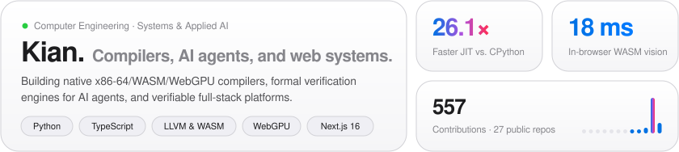
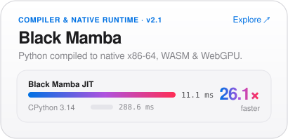
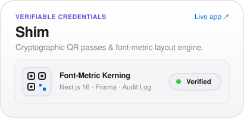
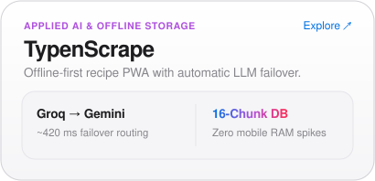
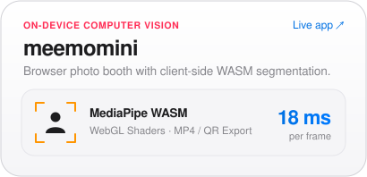
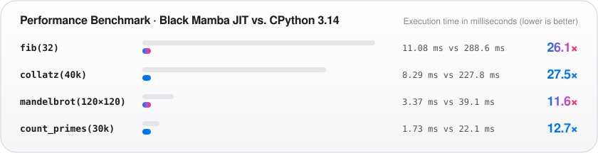
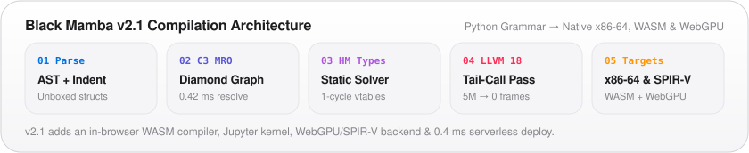
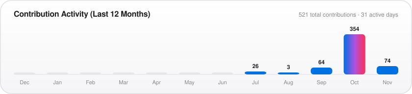

<p align="center">
  <picture><source media="(prefers-color-scheme: dark)" srcset="https://raw.githubusercontent.com/kicode01/kicode01/main/assets/sys-hero-dark-static.svg?v=apple6"><source media="(prefers-color-scheme: light)" srcset="https://raw.githubusercontent.com/kicode01/kicode01/main/assets/sys-hero-light-static.svg?v=apple6"></picture>
</p>

<p align="center">
  <a href="https://github.com/kicode01/blackmamba-lang" title="Black Mamba — Python syntax compiled to native x86-64 &amp; WASM (26.1x faster than CPython 3.14)"><picture><source media="(prefers-color-scheme: dark)" srcset="https://raw.githubusercontent.com/kicode01/kicode01/main/assets/card-mamba-dark-static.svg?v=apple6"><source media="(prefers-color-scheme: light)" srcset="https://raw.githubusercontent.com/kicode01/kicode01/main/assets/card-mamba-light-static.svg?v=apple6"></picture></a>&nbsp;<a href="https://shim-hq.vercel.app" title="Shim — Bulk verifiable event credentials with QR verification, audit logging &amp; font-metric kerning"><picture><source media="(prefers-color-scheme: dark)" srcset="https://raw.githubusercontent.com/kicode01/kicode01/main/assets/card-shim-dark-static.svg?v=apple6"><source media="(prefers-color-scheme: light)" srcset="https://raw.githubusercontent.com/kicode01/kicode01/main/assets/card-shim-light-static.svg?v=apple6"></picture></a>
</p>

<p align="center">
  <a href="https://github.com/kicode01/typenscrape" title="TypenScrape — Offline-first recipe generator with Groq to Gemini failover &amp; 16-chunk IndexedDB"><picture><source media="(prefers-color-scheme: dark)" srcset="https://raw.githubusercontent.com/kicode01/kicode01/main/assets/card-typenscrape-dark-static.svg?v=apple6"><source media="(prefers-color-scheme: light)" srcset="https://raw.githubusercontent.com/kicode01/kicode01/main/assets/card-typenscrape-light-static.svg?v=apple6"></picture></a>&nbsp;<a href="https://github.com/kicode01/meemomini" title="meemomini — Browser photo booth with on-device MediaPipe WASM segmentation (~18 ms/frame)"><picture><source media="(prefers-color-scheme: dark)" srcset="https://raw.githubusercontent.com/kicode01/kicode01/main/assets/card-meemomini-dark-static.svg?v=apple6"><source media="(prefers-color-scheme: light)" srcset="https://raw.githubusercontent.com/kicode01/kicode01/main/assets/card-meemomini-light-static.svg?v=apple6"></picture></a>
</p>

<details>
<summary><b>Project notes &amp; more builds</b> <sub>(Black Mamba, Shim, TypenScrape, meemomini, klyph-txt)</sub></summary>
<br>

- **[Black Mamba](https://github.com/kicode01/blackmamba-lang)** — Python's syntax with C's execution model. Includes an indentation-sensitive lexer/parser, dynamic C3 diamond multiple inheritance (`0.42 ms`), Hindley-Milner static type inference, LLVM 18 IR tail-call collapse (`5M -> 0` frames), direct `mmap` x86-64 JIT, and zero-dependency PE32+ / ELF64 / `1.7 KB` WASM linkers, plus native TLS 1.3, SQL, and RGB GUI libraries.
- **[Shim (`shim-platform`)](https://github.com/kicode01/shim-platform)** ([live app ↗](https://shim-hq.vercel.app)) — Bulk verifiable event credentials with cryptographic QR verification, audit logging, and real font-metric kerning layout built in Next.js 16 & Prisma.
- **[TypenScrape](https://github.com/kicode01/typenscrape)** — Offline-first recipe PWA. Routes generation to Groq (Llama 3, `~420 ms`) first and falls back to Gemini on rate limits. Streams its local catalog in 16 sequential chunks into IndexedDB to cap mobile RAM usage.
- **[meemomini](https://github.com/kicode01/meemomini)** — Browser photo booth running MediaPipe's `ImageSegmenter` in client-side WebAssembly (`~18 ms/frame`, zero server uploads) with still/GIF/MP4 export and QR handoff.
- **[klyph-txt](https://github.com/kicode01/klyph-txt)** — Text-engineering suite built around a closed-loop beam-search scorer over dependency-tree restructuring, 50,000+ LanguageTool/SymSpell rules, and WordNet 3.1 synonym ranking.

</details>

<details>
<summary><b>Speed benchmarks &amp; how the compiler works</b> <sub>(Black Mamba JIT vs. CPython 3.14)</sub></summary>
<br>
<p align="center">
  <picture><source media="(prefers-color-scheme: dark)" srcset="https://raw.githubusercontent.com/kicode01/kicode01/main/assets/sys-benchmark-dark-static.svg?v=apple6"><source media="(prefers-color-scheme: light)" srcset="https://raw.githubusercontent.com/kicode01/kicode01/main/assets/sys-benchmark-light-static.svg?v=apple6"></picture>
</p>
<p align="center">
  <picture><source media="(prefers-color-scheme: dark)" srcset="https://raw.githubusercontent.com/kicode01/kicode01/main/assets/sys-topology-dark-static.svg?v=apple6"><source media="(prefers-color-scheme: light)" srcset="https://raw.githubusercontent.com/kicode01/kicode01/main/assets/sys-topology-light-static.svg?v=apple6"></picture>
</p>
</details>

<details>
<summary><b>Coding activity &amp; recent commits</b> <sub>(12-month chart &amp; live repo feed)</sub></summary>
<br>
<p align="center">
  <picture><source media="(prefers-color-scheme: dark)" srcset="https://raw.githubusercontent.com/kicode01/kicode01/main/assets/sys-pulse-dark-static.svg?v=apple6"><source media="(prefers-color-scheme: light)" srcset="https://raw.githubusercontent.com/kicode01/kicode01/main/assets/sys-pulse-light-static.svg?v=apple6"></picture>
</p>

<!-- signal:start -->
**354 of 521** contributions landed in October alone.
<!-- signal:end -->

Filter repositories by language:
[`Python`](https://github.com/kicode01?tab=repositories&q=language%3APython) 4 &nbsp;·&nbsp; [`TypeScript`](https://github.com/kicode01?tab=repositories&q=language%3ATypeScript) 4 &nbsp;·&nbsp; [`HTML`](https://github.com/kicode01?tab=repositories&q=language%3AHTML) 3 &nbsp;·&nbsp; [`CSS`](https://github.com/kicode01?tab=repositories&q=language%3ACSS) 1 &nbsp;·&nbsp; [`JavaScript`](https://github.com/kicode01?tab=repositories&q=language%3AJavaScript) 1

<!-- pulse:start -->
```
blackmamba-lang    b97839a  2026-10-30  feat(v2.1): Pillar 0 (In-Browser WASM Compiler, Jupyter Kernel, WebGPU/SPIR-V Backend, 0.4ms Serverless Deploy) + Consumer Playground Speed Duel
shim-platform      767a03a  2026-10-30  chore: purge root junk files, untrack scratch directories, and clean repository structure
typenscrape        0211ebd  2026-10-30  docs: add MIT license and rewrite README as product showcase
meemomini          f2bf152  2026-10-30  refactor: consolidate backend, scripts, and deployment configs into deploy/ directory
klyph-txt          148b6e7  2026-10-23  chore: track logo-design-skill directly instead of embedded submodule
```
<!-- pulse:end -->
</details>

---

<p align="center">
  <sub>
    <b>Portfolio:</b> <a href="https://kicode01.github.io/">kicode01.github.io</a> &nbsp;·&nbsp;
    <b>Say hi:</b> <a href="https://github.com/kicode01/kicode01/issues/new?title=Hi%20Kian&body=Where%20I%20found%20you%3A%0A%0AWhat%20you%27re%20working%20on%3A%0A%0A">Open a prefilled issue ↗</a> &nbsp;·&nbsp;
    <b>Visitor guestbook:</b> <a href="https://github.com/kicode01/kicode01/issues/new?template=telemetry_ping.yml&title=%5BTELEMETRY+PING%5D+from+%40your-handle">Leave a ping ↗</a>
  </sub>
</p>
