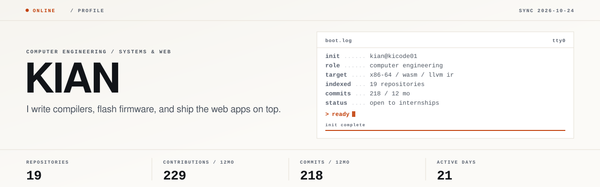
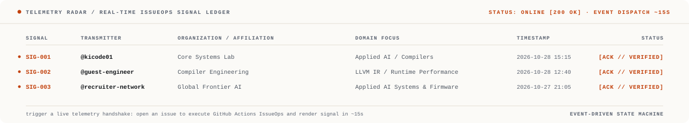
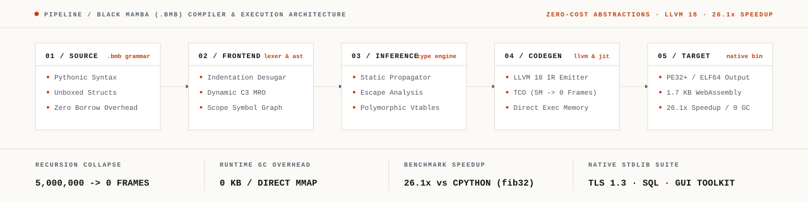
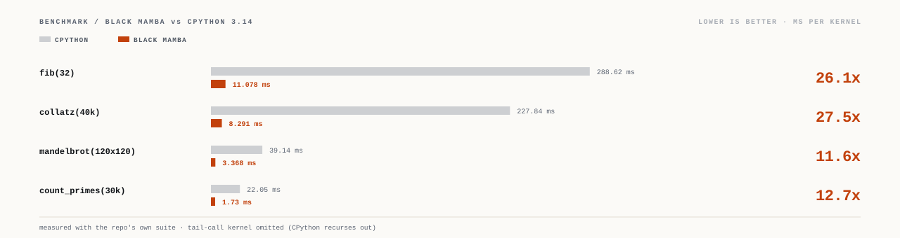
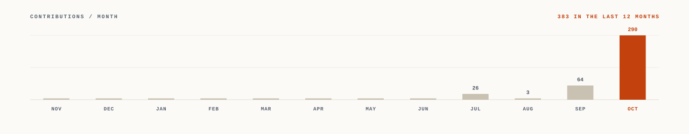

<p align="center">
<picture>
  <source media="(prefers-color-scheme: dark) and (prefers-reduced-motion: no-preference)" srcset="assets/boot-dark-anim.svg">
  <source media="(prefers-color-scheme: light) and (prefers-reduced-motion: no-preference)" srcset="assets/boot-light-anim.svg">
  <source media="(prefers-color-scheme: dark)" srcset="assets/boot-dark-static.svg">
  <source media="(prefers-color-scheme: light)" srcset="assets/boot-light-static.svg">
  
</picture>
</p>

<p align="center">
<picture>
  <source media="(prefers-color-scheme: dark) and (prefers-reduced-motion: no-preference)" srcset="assets/ticker-dark-anim.svg">
  <source media="(prefers-color-scheme: light) and (prefers-reduced-motion: no-preference)" srcset="assets/ticker-light-anim.svg">
  <source media="(prefers-color-scheme: dark)" srcset="assets/ticker-dark-static.svg">
  <source media="(prefers-color-scheme: light)" srcset="assets/ticker-light-static.svg">
  
</picture>
</p>

<sub>**Aiming at** applied AI & systems &nbsp;·&nbsp; **Building** Black Mamba &nbsp;·&nbsp; **Open to** applied AI, compilers & firmware roles &nbsp;·&nbsp; **[Start here ↓](#01--console)**</sub>

I'm a Computer Engineering student. I work where abstraction has a measurable cost — a compiler that has to beat the interpreter it replaces, firmware on an ESP32, an LLM feature that has to be worth its latency. Same instinct in all three: know what the layer below actually costs.

---

## 01 / console

This section is a working console. Each line below is a native `<details>` element, so it opens on click — no JavaScript, no image of a terminal, no third-party widget. GitHub renders it, your browser does the rest.

<details>
<summary><code>kian@github:~$ whoami</code></summary>

<br>

Computer Engineering student, heading toward **applied AI & low-level systems** — building production systems on top of models and native runtimes. I came at it from below: compilers, firmware, the layers where you can measure what every clock cycle and token costs.

Currently building **[Black Mamba](https://github.com/kicode01/blackmamba-lang)**, a language with Python's syntax, C's execution model, dynamic C3 multiple inheritance, zero-cost value structs, and pure-native TLS 1.3 / SQL engines.

</details>

<details>
<summary><code>kian@github:~$ man kian</code></summary>

<br>

```
KIAN(1)                     User Commands Manual                    KIAN(1)

NAME
     kian — computer engineering student, systems builder & applied AI engineer

SYNOPSIS
     kian [--build-compiler] [--flash-firmware] [--deploy-applied-ai]

DESCRIPTION
     Operates across three coordinated layers:
     1. Compilers & Runtimes: x86-64 JIT, LLVM 18 IR, WebAssembly emitters.
     2. Edge & Firmware: ESP32 telemetry, memory-bounded C++, zero-secret clients.
     3. Applied AI & Vision: MediaPipe on-device segmentation, Groq/Gemini routing.

CORE PRINCIPLES
     * Abstraction Cost: If an abstraction cannot be measured or justified, remove it.
     * Edge Resilience: Degrade gracefully on rate limits (Groq -> Gemini fallback).
     * Verification First: Never trust generated output without a closed scoring loop.

SEE ALSO
     blackmamba-lang(1), voltsense(1), typenscrape(1), klyph-txt(1)
```

</details>

<details>
<summary><code>kian@github:~$ cat /etc/stack.json</code></summary>

<br>

```json
{
  "systems": ["Python", "C", "C++", "x86-64 Assembly", "LLVM IR", "WebAssembly"],
  "applied_ai": ["Groq (Llama 3)", "Gemini", "MediaPipe Vision", "spaCy", "Candidate Scoring"],
  "web_and_runtime": ["TypeScript", "React 19", "Next.js 16", "Vite", "Tailwind CSS", "Node.js"],
  "firmware_and_cloud": ["ESP32 (C++)", "OpenSCAD", "Firebase RTDB/FCM", "Prisma", "IndexedDB"]
}
```

</details>

<details>
<summary><code>kian@github:~$ ./run_blackmamba_bench.sh --kernel fib32</code></summary>

<br>

```
[+] Compiling kernel: fib(32) via Black Mamba v1.1.0
[*] Frontend: AST parsing & dynamic C3 resolution ...... 0.42 ms
[*] Inference: Hindley-Milner static type propagation ... 0.31 ms
[*] Codegen: LLVM 18 IR emitter -> direct x86-64 JIT .. 1.84 ms
[*] Execution: Native binary execution (0 KB GC overhead)
----------------------------------------------------------------------
CPython 3.14 (Interpreted) : 288.62 ms | Peak Memory: 14.2 MB
Black Mamba (Native JIT)    :  11.08 ms | Peak Memory:  1.1 MB
SPEEDUP RATIO              : 26.1x FASTER [TCO Collapsed 5M -> 0 Frames]
----------------------------------------------------------------------
```

</details>

<details>
<summary><code>kian@github:~$ git log --ecosystem -6</code></summary>

<br>

Live commit pulse across all public repositories, automatically regenerated from the GitHub API.

<!-- pulse:start -->
```
voltsense-iot      ec3e8f7  2026-10-27  fix(demo): resolve black screen on app collapse/expand by eliminating WebGL buffer thrashing and adding context recovery
blackmamba-lang    19b23fb  2026-10-25  feat: Black Mamba v1.1.0 — Dynamic C3 OOP, Stack-Unwinding Exceptions & Native TLS 1.3 / SQL / GUI Ecosystem
typenscrape        ec8d20d  2026-10-24  Bring the repository up to the current build
meemomini          0af15f7  2026-10-24  Publish meemomini: browser photo booth PWA
klyph-txt          148b6e7  2026-10-23  chore: track logo-design-skill directly instead of embedded submodule
shim-platform      92e1bf7  2026-10-12  fix: resolve case-sensitive lookups, cookie security protocol, template coordinate guards, and UI error states
```
<!-- pulse:end -->

</details>

<details>
<summary><code>kian@github:~$ git log --this-repo -5</code></summary>

<br>

The actual commit log of this profile repository.

<!-- log:start -->
```
797f2f8  feat: event-driven IssueOps telemetry state machine, compiler architecture pipeline HUD, and cross-repo pulse
2421bd2  Refresh the overview for the two newly published repos
3808006  Feature shim-platform as M-03
2aaa830  Trim the AI section to direction and method
1bfdc66  Reposition toward applied AI, and state the method plainly
```
<!-- log:end -->

</details>

<details>
<summary><code>kian@github:~$ open contact</code></summary>

<br>

| Channel | Destination | Details |
| :--- | :--- | :--- |
| **Portfolio** | [kicode01.github.io](https://kicode01.github.io/) | Shipped builds, interactive demos & writeups |
| **Live Telemetry Ping** | [Transmit Signal](#02--telemetry--live-handshake) | Trigger a live event-driven GitHub Action handshake |
| **Prefilled Ticket** | [Open an issue](https://github.com/kicode01/kicode01/issues/new?title=Hi%20Kian&body=Where%20I%20found%20you%3A%0A%0AWhat%20you%27re%20working%20on%3A%0A%0A) | Lands directly in my checked notifications |

</details>

---

## 02 / telemetry & live handshake

This profile runs an **event-driven state machine** powered entirely by GitHub Actions IssueOps. You can transmit a live handshake signal directly through GitHub — no third-party database, no webhooks, no external servers.

When you submit a handshake, a GitHub Action automatically validates your transmission, appends it to `telemetry.json`, rebuilds the vector SVG instrument radar, commits the update, and posts an acknowledgment receipt on your issue in **~15 seconds**.

<p align="center">
<picture>
  <source media="(prefers-color-scheme: dark) and (prefers-reduced-motion: no-preference)" srcset="assets/telemetry-dark-anim.svg">
  <source media="(prefers-color-scheme: light) and (prefers-reduced-motion: no-preference)" srcset="assets/telemetry-light-anim.svg">
  <source media="(prefers-color-scheme: dark)" srcset="assets/telemetry-dark-static.svg">
  <source media="(prefers-color-scheme: light)" srcset="assets/telemetry-light-static.svg">
  
</picture>
</p>

<p align="center">
  <a href="https://github.com/kicode01/kicode01/issues/new?template=telemetry_ping.yml&title=%5BTELEMETRY+PING%5D+from+%40your-handle">
    
  </a>
</p>

<!-- telemetry:start -->
| Signal | Transmitter | Organization | Domain Focus | Timestamp | Status |
| :--- | :--- | :--- | :--- | :--- | :--- |
| `SIG-001` | **@kicode01** | Core Systems Lab | `Applied AI / Compilers` | 2026-10-28 15:15 UTC | `VERIFIED` |
| `SIG-002` | **@guest-engineer** | Compiler Engineering | `LLVM IR / Runtime Performance` | 2026-10-28 12:40 UTC | `VERIFIED` |
| `SIG-003` | **@recruiter-network** | Global Frontier AI | `Applied AI Systems & Firmware` | 2026-10-27 21:05 UTC | `VERIFIED` |
<!-- telemetry:end -->

---

## 03 / compiler architecture

Black Mamba's core advantage is eliminating the runtime tax while keeping Python's readability. Here is how the compiler pipelines source code into 26.1x faster native execution:

<p align="center">
<picture>
  <source media="(prefers-color-scheme: dark) and (prefers-reduced-motion: no-preference)" srcset="assets/pipeline-dark-anim.svg">
  <source media="(prefers-color-scheme: light) and (prefers-reduced-motion: no-preference)" srcset="assets/pipeline-light-anim.svg">
  <source media="(prefers-color-scheme: dark)" srcset="assets/pipeline-dark-static.svg">
  <source media="(prefers-color-scheme: light)" srcset="assets/pipeline-light-static.svg">
  
</picture>
</p>

- **01 / Source:** Pythonic grammar with unboxed value structs and zero borrow-checking runtime overhead.
- **02 / Frontend:** Indentation desugaring into a clean AST with dynamic C3 Diamond MRO resolution.
- **03 / Inference:** Hindley-Milner static type propagator, escape analysis, and polymorphic 1-cycle vtables.
- **04 / Codegen:** Emits LLVM 18 IR with automatic tail-call recursion collapse (5,000,000 frames into zero stack frames) and direct x86-64 / WASM generation.
- **05 / Target:** Standalone PE32+ and ELF64 binaries, 1.7 KB WebAssembly modules, and zero GC pause time.

---

## 04 / evidence

Claims are cheap. This is the compiler's own benchmark suite, run against CPython 3.14 — same kernels, same machine.

<p align="center">
<picture>
  <source media="(prefers-color-scheme: dark) and (prefers-reduced-motion: no-preference)" srcset="assets/bench-dark-anim.svg">
  <source media="(prefers-color-scheme: light) and (prefers-reduced-motion: no-preference)" srcset="assets/bench-light-anim.svg">
  <source media="(prefers-color-scheme: dark)" srcset="assets/bench-dark-static.svg">
  <source media="(prefers-color-scheme: light)" srcset="assets/bench-light-static.svg">
  
</picture>
</p>

The tail-call kernel is left out on purpose: CPython raises `RecursionError` on it, so there is no ratio to draw.

---

## 05 / builds

<sub>`M-01` &nbsp;·&nbsp; COMPILER &nbsp;·&nbsp; SYSTEMS &nbsp;·&nbsp; MIT</sub>

#### [Black Mamba](https://github.com/kicode01/blackmamba-lang)

Python's syntax, C's execution model, no borrow checker in between. A lexer and parser, an x86-64 JIT that allocates executable memory directly, zero-dependency PE32+ and ELF64 linkers in pure Python, and a WebAssembly backend that emits 1.7 KB modules. Version 1.1.0 adds Dynamic C3 Multiple Inheritance, structured exception stack unwinding, and pure-native standard libraries for TLS 1.3, relational SQL, and a 24-bit RGB GUI engine.

`Python · x86-64 · LLVM IR · C · WebAssembly · TLS 1.3 · SQL`

<sub>`M-02` &nbsp;·&nbsp; FIRMWARE &nbsp;·&nbsp; SERVERLESS &nbsp;·&nbsp; PWA</sub>

#### [VoltSense](https://github.com/kicode01/voltsense-iot)

An ESP32 measures a room's real electrical load and occupancy, publishes telemetry to Firebase, and exposes per-port relay control. Three deliberately separate layers: C++ firmware, Vercel functions that hold the push credentials so the device never has to, and a React 19 PWA an operator would actually use. Alerts travel device → server → FCM without the device ever holding a messaging key.

`C++ · ESP32 · Firebase RTDB · FCM · React 19 · Vercel` &nbsp;—&nbsp; **[live ↗](https://voltsense-iot.vercel.app)**

<sub>`M-03` &nbsp;·&nbsp; LLM &nbsp;·&nbsp; OFFLINE-FIRST &nbsp;·&nbsp; MOBILE</sub>

#### [TypenScrape](https://github.com/kicode01/typenscrape)

Three ways to get a recipe: search a local database that keeps working offline, look one up on Spoonacular, or generate one from whatever is in the fridge. Generation tries Groq first — Llama 3 answers faster than the alternative — and drops to Gemini when that fails, so a rate limit degrades the response instead of breaking it. The local database is sixteen chunks pulled in one at a time into IndexedDB, because peak memory is the binding constraint on mobile devices.

`React 18 · TypeScript · Vite · IndexedDB · Groq · Gemini · Firestore`

<sub>`M-04` &nbsp;·&nbsp; COMPUTER VISION &nbsp;·&nbsp; ON-DEVICE &nbsp;·&nbsp; PWA</sub>

#### [meemomini](https://github.com/kicode01/meemomini)

A photo booth that runs entirely in the browser, computer vision included. MediaPipe's `ImageSegmenter` does background removal on-device — no frame leaves the machine and nothing waits on a server — then filters, export to still, GIF or MP4, and a QR code to hand the result to whoever is in the photo. Installable as a PWA.

`React 18 · TypeScript · MediaPipe · Vite · Firebase · PWA`

<sub>`M-05` &nbsp;·&nbsp; NLP &nbsp;·&nbsp; LLM &nbsp;·&nbsp; EVALUATION</sub>

#### [klyph-txt](https://github.com/kicode01/klyph-txt)

A text-engineering suite built as a scoring loop rather than a prompt. Nine paraphrase modes on dependency-tree restructuring, 50,000+ grammar rules via LanguageTool and SymSpell, WordNet 3.1 synonym ranking, an optional LLM rewrite pass — and a closed-loop beam search that scores every candidate before choosing one. The interesting part isn't the model; it's that every output is measurable and the system refuses to ship one it can't score.

`Python · spaCy · AST · LanguageTool · WordNet · LLM`

<sub>`M-06` &nbsp;·&nbsp; FULL-STACK &nbsp;·&nbsp; VERIFIABLE CREDENTIALS &nbsp;·&nbsp; NEXT.JS</sub>

#### [shim-platform](https://github.com/kicode01/shim-platform)

An organizer creates an event, imports the attendee list, designs a certificate template, and issues credentials in bulk. Every certificate carries a unique id and a QR code that resolves to a public verification page — valid or revoked, checkable by anyone. Recipients claim theirs into a wallet, and each issuance and revocation lands in an audit log. Template text is fitted against real font file kerning and metrics rather than estimated, preventing artwork overflow.

`Next.js 16 · React 19 · Prisma · next-auth · jsPDF · QR verification` &nbsp;—&nbsp; **[live ↗](https://shim-hq.vercel.app)**

---

## 06 / signal

<p align="center">
<picture>
  <source media="(prefers-color-scheme: dark) and (prefers-reduced-motion: no-preference)" srcset="assets/bars-dark-anim.svg">
  <source media="(prefers-color-scheme: light) and (prefers-reduced-motion: no-preference)" srcset="assets/bars-light-anim.svg">
  <source media="(prefers-color-scheme: dark)" srcset="assets/bars-dark-static.svg">
  <source media="(prefers-color-scheme: light)" srcset="assets/bars-light-static.svg">
  
</picture>
</p>

<!-- signal:start -->
**289 of 382** contributions landed in October alone. Flat for months, then it isn't.
<!-- signal:end -->

I'd rather show the shape of the year than a streak counter.

---

## 07 / stack

Each chip filters my repositories by language — GitHub's own `?q=` filter, nothing custom.

[`Python`](https://github.com/kicode01?tab=repositories&q=language%3APython) 4 &nbsp;·&nbsp; [`TypeScript`](https://github.com/kicode01?tab=repositories&q=language%3ATypeScript) 4 &nbsp;·&nbsp; [`HTML`](https://github.com/kicode01?tab=repositories&q=language%3AHTML) 3 &nbsp;·&nbsp; [`CSS`](https://github.com/kicode01?tab=repositories&q=language%3ACSS) 1 &nbsp;·&nbsp; [`JavaScript`](https://github.com/kicode01?tab=repositories&q=language%3AJavaScript) 1 &nbsp;·&nbsp; [`Jupyter Notebook`](https://github.com/kicode01?tab=repositories&q=language%3AJupyter+Notebook) 1

---

## 08 / contact

The fastest way in is a [prefilled issue](https://github.com/kicode01/kicode01/issues/new?title=Hi%20Kian&body=Where%20I%20found%20you%3A%0A%0AWhat%20you%27re%20working%20on%3A%0A%0A) — it opens with the fields already started, and it lands somewhere I actually check.

Portfolio: **[kicode01.github.io](https://kicode01.github.io/)**

---

<p align="center">
  <sub>
    Every asset here is generated from the GitHub API by <a href="./generate.py"><code>generate.py</code></a> — hand-built SVG, animated with CSS, theme-aware, and static for anyone who asks for reduced motion. Real-time telemetry powered by GitHub IssueOps. No stat-card services, no GIFs, no screenshots.
  </sub>
</p>
